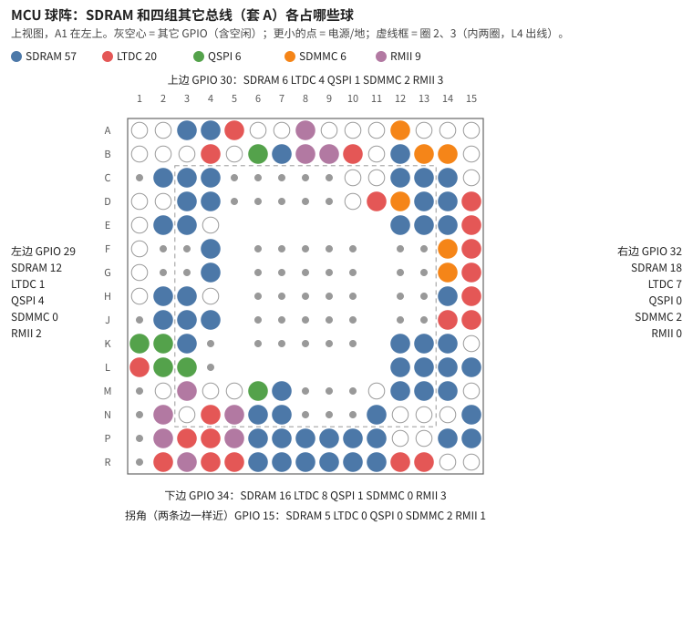
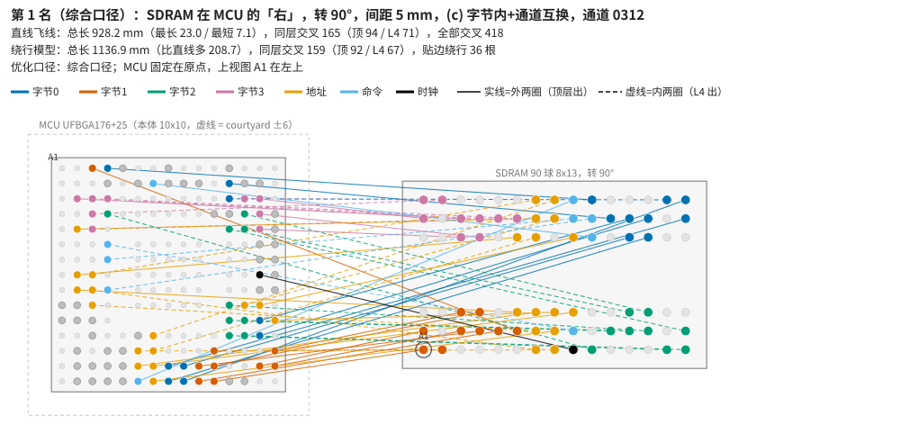
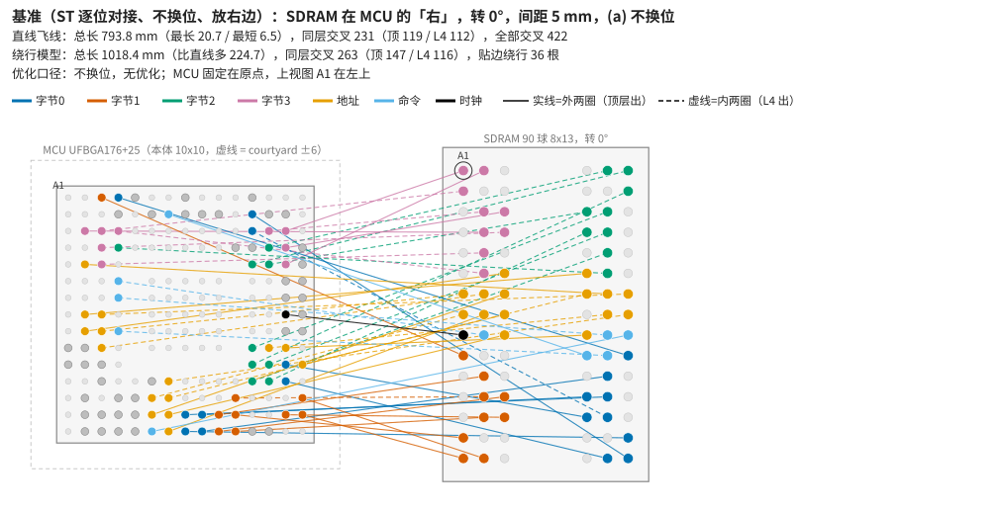
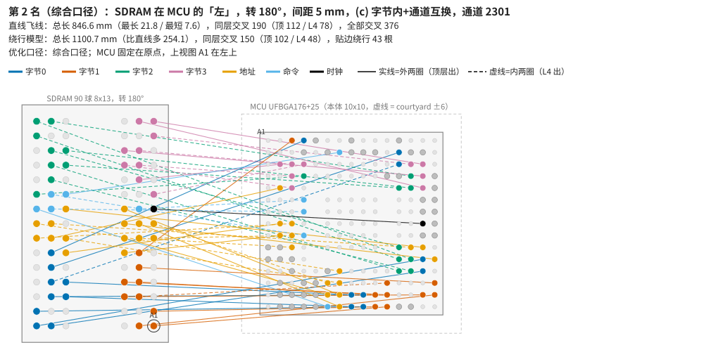
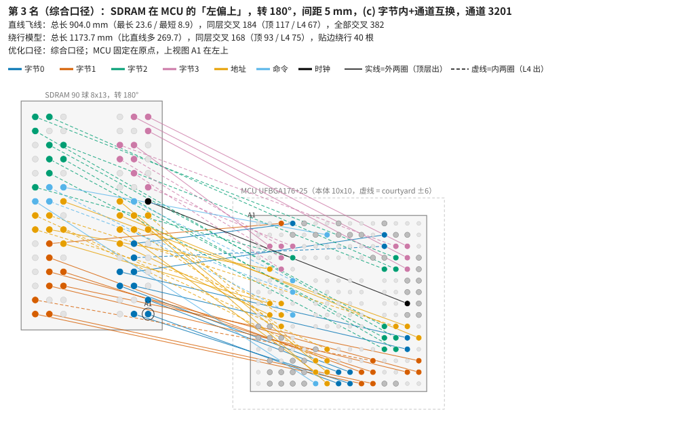

# SDRAM 摆在 MCU 哪一边：飞线级对比

分支 `research/sdram-placement-study`，只存档不合并。日期 2026-11-16。目的：给"32 位 SDRAM 放在 MCU 哪一边、转多少度、允许哪些换位"这个布局前的决定提供数字（RTE-1：线序当迭代问题，器件位置、旋转、可交换的位都是变量）。这是飞线估计，不是布线；没有打开或生成 KiCad 工程。

器件：MCU = STM32H743IIK6（UFBGA176+25，10 × 10 mm，球距 0.65），SDRAM = ISSI IS42S32800J（90 球，8 × 13 mm，球距 0.8），都在顶层。外设取调研 h7-peripheral-pinmux 的"套 A"（LTDC + 以太网 RMII + SDMMC1 + FDCAN1，QSPI 取套 A 一列）。

## 排名表和结论

基准 = ST 的一一对应、不换位、SDRAM 放右边（四个旋转里取最好的，是转 0°）、间距 5 mm。下面"有效交叉"指两根线出线层相同（外两圈顶层、内两圈 L4）的交叉对数。

**三句话结论**

1. **摆法**：SDRAM 放在 MCU 右边、本体间距 5 mm，在两种口径下都排第一（右、转 90°、允许字节通道互换 (c)，通道 0312 / 3102）：同层交叉比基准少 34%（规格口径 231 → 152，综合口径 494 → 324），代价是总长多 12–17%（直线 793.8 → 927.0 mm，绕行 1018.4 → 1136.9 mm）；同样放右边、转 180°、(c) 的摆法交叉少 22–27% 而总长不增（直线 786.2 mm，绕行 999.7 mm），是不加长的那一档；间距 10 mm 比 5 mm 平均多 5 mm/根（总共约 300 mm）、交叉也略多；四个角位最差（综合口径最好的角位 384–478 交叉、绕行总长 1387–1557 mm，都比右边居中差），"偏"位只在个别边上比居中少交叉（下偏左比下），没有一个超过右边居中的 90°。
2. **换位**：(c) 是最值钱的自由度——128 个摆法上平均把同层交叉降 39%（综合口径 32%），其中 124 个摆法比只做字节内换位的 (b) 更少，总长基本不变（平均 −1% 到 −2%）；只做 (b) 平均降 16%（综合 11%）。基准摆法上 (b) 把 231 降到 177（−23%）且总长不变，该摆法上字节通道互换没有额外收益；(c) 相对 (b) 的收益随 SDRAM 的旋转而变（规格口径平均：转 0° 为 10%，90° 为 31%，180° 为 42%，270° 为 26%），所以"转多少度"和"允不允许换通道"要一起定，原理图阶段就要允许（SDRAM 一侧的 DQ 网络名和 DQMn 可以改）。
3. **代价和不确定**：交叉少不等于线序好排——前几名候选都有 36–43 根线要贴着 MCU 的 courtyard 绕行，最好的右 90° 把 SDRAM 线束绕到上下两边（两边中点各约 15、12 根），LTDC / QSPI / SDMMC / RMII 的出线走廊被横穿的根数从基准的 20/41 增到 30/41（右偏上 90° 只有 17/41，但同层交叉多到 393），字节内的长度极差也没有变小（最好候选的字节内极差 5.2–12.3 mm，基准 6.5–8.9 mm）；这些数字是飞线估计，没算扇出通道容量，交叉数也不等于过孔数（见"局限"）。

两个口径的第一名是同一个摆法，第 2、3 名各自不同（见下表），前 10 名里两个口径共有的摆法只有四个：右 90° 间距 5、右 90° 间距 10、左 180° 间距 5、左偏下 180° 间距 5。

<!--BEGIN:rank-->
**按综合口径排名（同层直线交叉 + 同层绕行交叉之和优先，再比绕行总长）**；共 384 个候选，下表前 6 名加基准。

| 名次 | 摆法 | 换位档 | 综合交叉（同层） | 绕行有效交叉（同层） | 其中 数据内 / 地址命令内 / 混合 | 绕行 总长 / 最长 / 最短 / 极差 mm | 比直线多绕 mm | 贴边绕行的线数 | 最宽线束（根） |
|---|---|---|---|---|---|---|---|---|---|
| 1 | 右，转90°，间距5 | (c) 字节内+通道互换（通道 0312） | 324（直线 165 + 绕行 159） | 159（顶92 / L4 67） | 41 / 31 / 87 | 1136.9 / 34.7 / 7.1 / 27.6 | 208.7 | 36 | 15 |
| 2 | 左，转180°，间距5 | (c) 字节内+通道互换（通道 2301） | 340（直线 190 + 绕行 150） | 150（顶102 / L4 48） | 53 / 31 / 66 | 1100.7 / 34.6 / 7.6 / 27.1 | 254.1 | 43 | 19 |
| 3 | 左偏上，转180°，间距5 | (c) 字节内+通道互换（通道 3201） | 352（直线 184 + 绕行 168） | 168（顶93 / L4 75） | 73 / 40 / 55 | 1173.7 / 34.2 / 9.6 / 24.6 | 269.7 | 40 | 15 |
| 4 | 左偏上，转180°，间距10 | (c) 字节内+通道互换（通道 3201） | 357（直线 187 + 绕行 170） | 170（顶96 / L4 74） | 80 / 38 / 52 | 1423.4 / 38.9 / 13.7 / 25.2 | 252.8 | 40 | 15 |
| 5 | 右，转90°，间距10 | (c) 字节内+通道互换（通道 0312） | 363（直线 173 + 绕行 190） | 190（顶121 / L4 69） | 63 / 31 / 96 | 1406.7 / 39.5 / 12.0 / 27.5 | 197.3 | 36 | 15 |
| 6 | 左，转0°，间距5 | (c) 字节内+通道互换（通道 3012） | 368（直线 219 + 绕行 149） | 149（顶96 / L4 53） | 44 / 37 / 68 | 1106.3 / 34.6 / 7.6 / 27.0 | 258.7 | 43 | 24 |
| 基准（第 132 名） | 右，转0°，间距5 | (a) 不换位 | 494（直线 231 + 绕行 263） | 263（顶147 / L4 116） | 97 / 30 / 136 | 1018.4 / 33.2 / 6.5 / 26.6 | 224.7 | 36 | 15 |

同一批候选的另一套数字：

| 名次 | 摆法 | 换位档 | 有效交叉（同层） | 全部交叉 | 直线 总长 / 最长 / 最短 / 极差 mm | 曼哈顿 总长 / 最长 / 最短 / 极差 mm |
|---|---|---|---|---|---|---|
| 1 | 右，转90°，间距5 | (c) 字节内+通道互换（通道 0312） | 165（顶94 / L4 71） | 418（数据131 / 地址命令79 / 混合208） | 928.2 / 23.0 / 7.1 / 15.9 | 1051.8 / 29.2 / 7.7 / 21.5 |
| 2 | 左，转180°，间距5 | (c) 字节内+通道互换（通道 2301） | 190（顶112 / L4 78） | 376（数据130 / 地址命令78 / 混合168） | 846.6 / 21.8 / 7.6 / 14.2 | 964.2 / 28.0 / 7.7 / 20.3 |
| 3 | 左偏上，转180°，间距5 | (c) 字节内+通道互换（通道 3201） | 184（顶117 / L4 67） | 382（数据108 / 地址命令87 / 混合187） | 904.0 / 23.6 / 8.9 / 14.7 | 1162.4 / 32.2 / 10.1 / 22.1 |
| 4 | 左偏上，转180°，间距10 | (c) 字节内+通道互换（通道 3201） | 187（顶116 / L4 71） | 393（数据116 / 地址命令87 / 混合190） | 1170.6 / 27.2 / 13.5 / 13.8 | 1447.5 / 36.2 / 15.2 / 21.1 |
| 5 | 右，转90°，间距10 | (c) 字节内+通道互换（通道 0312） | 173（顶99 / L4 74） | 428（数据130 / 地址命令82 / 混合216） | 1209.5 / 27.8 / 12.0 / 15.8 | 1335.2 / 33.4 / 12.7 / 20.7 |
| 6 | 左，转0°，间距5 | (c) 字节内+通道互换（通道 3012） | 219（顶138 / L4 81） | 480（数据162 / 地址命令94 / 混合224） | 847.6 / 22.4 / 7.6 / 14.8 | 984.9 / 28.7 / 8.3 / 20.3 |
| 基准（第 132 名） | 右，转0°，间距5 | (a) 不换位 | 231（顶119 / L4 112） | 422（数据162 / 地址命令90 / 混合170） | 793.8 / 20.7 / 6.5 / 14.3 | 918.2 / 26.0 / 7.7 / 18.2 |

**按直线飞线排名（规格口径：同层交叉数优先，再比直线总长）**；共 384 个候选，下表前 6 名加基准。

| 名次 | 摆法 | 换位档 | 有效交叉（同层） | 全部交叉 | 直线 总长 / 最长 / 最短 / 极差 mm | 曼哈顿 总长 / 最长 / 最短 / 极差 mm |
|---|---|---|---|---|---|---|
| 1 | 右，转90°，间距5 | (c) 字节内+通道互换（通道 3102） | 152（顶74 / L4 78） | 361（数据104 / 地址命令79 / 混合178） | 927.0 / 22.7 / 7.0 / 15.7 | 1040.3 / 29.1 / 7.2 / 21.9 |
| 2 | 右偏上，转90°，间距5 | (c) 字节内+通道互换（通道 0132） | 153（顶83 / L4 70） | 335（数据79 / 地址命令84 / 混合172） | 980.2 / 24.6 / 7.7 / 16.9 | 1243.2 / 33.6 / 8.3 / 25.3 |
| 3 | 左，转180°，间距5 | (c) 字节内+通道互换（通道 2301） | 154（顶85 / L4 69） | 341（数据95 / 地址命令78 / 混合168） | 845.9 / 21.4 / 7.6 / 13.8 | 958.8 / 27.9 / 7.7 / 20.2 |
| 4 | 右偏上，转180°，间距5 | (c) 字节内+通道互换（通道 2310） | 156（顶65 / L4 91） | 340（数据90 / 地址命令94 / 混合156） | 848.6 / 21.0 / 7.4 / 13.6 | 1100.5 / 26.8 / 9.7 / 17.0 |
| 5 | 下偏左，转90°，间距5 | (c) 字节内+通道互换（通道 3012） | 158（顶107 / L4 51） | 387（数据112 / 地址命令65 / 混合210） | 838.1 / 24.3 / 6.9 / 17.5 | 1070.8 / 33.6 / 9.2 / 24.5 |
| 6 | 右偏上，转90°，间距10 | (c) 字节内+通道互换（通道 0132） | 158（顶89 / L4 69） | 370（数据105 / 地址命令85 / 混合180） | 1250.2 / 29.7 / 12.7 / 17.0 | 1528.2 / 39.2 / 13.3 / 25.9 |
| 基准（第 106 名） | 右，转0°，间距5 | (a) 不换位 | 231（顶119 / L4 112） | 422（数据162 / 地址命令90 / 混合170） | 793.8 / 20.7 / 6.5 / 14.3 | 918.2 / 26.0 / 7.7 / 18.2 |

同一批候选的另一套数字：

| 名次 | 摆法 | 换位档 | 综合交叉（同层） | 绕行有效交叉（同层） | 其中 数据内 / 地址命令内 / 混合 | 绕行 总长 / 最长 / 最短 / 极差 mm | 比直线多绕 mm | 贴边绕行的线数 | 最宽线束（根） |
|---|---|---|---|---|---|---|---|---|---|
| 1 | 右，转90°，间距5 | (c) 字节内+通道互换（通道 3102） | 365（直线 152 + 绕行 213） | 213（顶138 / L4 75） | 76 / 31 / 106 | 1135.6 / 34.7 / 7.0 / 27.7 | 208.6 | 36 | 15 |
| 2 | 右偏上，转90°，间距5 | (c) 字节内+通道互换（通道 0132） | 399（直线 153 + 绕行 246） | 246（顶162 / L4 84） | 75 / 44 / 127 | 1190.2 / 34.2 / 7.7 / 26.5 | 210.0 | 30 | 9 |
| 3 | 左，转180°，间距5 | (c) 字节内+通道互换（通道 2301） | 361（直线 154 + 绕行 207） | 207（顶134 / L4 73） | 97 / 31 / 79 | 1102.0 / 33.2 / 7.6 / 25.7 | 256.1 | 43 | 21 |
| 4 | 右偏上，转180°，间距5 | (c) 字节内+通道互换（通道 2310） | 420（直线 156 + 绕行 264） | 264（顶150 / L4 114） | 75 / 38 / 151 | 1069.2 / 32.7 / 7.7 / 25.1 | 220.6 | 32 | 10 |
| 5 | 下偏左，转90°，间距5 | (c) 字节内+通道互换（通道 3012） | 407（直线 158 + 绕行 249） | 249（顶167 / L4 82） | 112 / 33 / 104 | 1025.5 / 35.0 / 7.1 / 27.9 | 187.4 | 33 | 8 |
| 6 | 右偏上，转90°，间距10 | (c) 字节内+通道互换（通道 0132） | 398（直线 158 + 绕行 240） | 240（顶158 / L4 82） | 65 / 39 / 136 | 1449.0 / 39.2 / 12.7 / 26.5 | 198.9 | 30 | 10 |
| 基准（第 106 名） | 右，转0°，间距5 | (a) 不换位 | 494（直线 231 + 绕行 263） | 263（顶147 / L4 116） | 97 / 30 / 136 | 1018.4 / 33.2 / 6.5 / 26.6 | 224.7 | 36 | 15 |
<!--END:rank-->

各换位档最好的成绩和对基准的改善：

<!--BEGIN:tiers-->
| 口径 | 换位档 | 该档最好的摆法 | 有效交叉 | 对基准 | 总长 mm | 对基准 |
|---|---|---|---|---|---|---|
| 综合口径 | (a) 不换位 | 左偏上，转0°，间距5 | 440 | -11% | 1178.8 | +15.7% |
| 综合口径 | (b) 字节内换位 | 右，转0°，间距5 | 382 | -23% | 1009.1 | -0.9% |
| 综合口径 | (c) 字节内+通道互换 | 右，转90°，间距5，通道 0312 | 324 | -34% | 1136.9 | +11.6% |
| 直线飞线（规格口径） | (a) 不换位 | 右，转0°，间距5 | 231 | +0% | 793.8 | +0.0% |
| 直线飞线（规格口径） | (b) 字节内换位 | 左，转0°，间距5 | 176 | -24% | 844.6 | +6.4% |
| 直线飞线（规格口径） | (c) 字节内+通道互换 | 右，转90°，间距5，通道 3102 | 152 | -34% | 927.0 | +16.8% |
<!--END:tiers-->

## 一、比的是什么

对每个候选，57 根信号各画一根飞线（MCU 球 → SDRAM 球），算两套数字。

**规格口径（直线飞线）**，就是要求的那套：

- 长度：直线（欧氏）和曼哈顿各算总长、最长、最短、极差；按组（四个字节、地址、命令、时钟）给最短–最长。
- 交叉：飞线两两线段真相交的对数；分全部、数据内部、地址命令内部、混合。
- 外两圈（圈 0、1，顶层出线）和内两圈（圈 2、3，打孔后从 L4 出线）互不妨碍，所以"有效交叉"只数两根线出线层相同的对（顶层对顶层、L4 对 L4）。出线层按 MCU 一侧的球圈号定；SDRAM 的球全在顶层，不影响出线层的判断。

**绕行模型（我加的补充）**。直线飞线会穿过 MCU 的球阵，实际走线不能这样走。RTE-1 的教训正是"绕封装一圈"。所以每根线另算一条"绕行路径"：从球垂直走到离它最近的那条边的 courtyard（MCU 封装库里 ±6 mm 的方框），然后沿着 courtyard 外缘绕到 SDRAM 球，取直线能看见时直走、否则贴边拐角的最短路径。由此得到：

- 绕行总长、最长、最短、极差；比直线多绕多少。
- 绕行交叉：两根线的绕行路径是否"必须交叉"。规则：同方向贴边时，一根的贴边区间严格嵌在另一根里面就必交叉一次（里面那根出线或离开时要穿过外面那根）；反方向贴边且区间重叠必交叉；离开 courtyard 后的直线段按几何相交判；在同一个角离开的线，贴边更长的在外圈。同样只数同一出线层上的对。
- 贴边绕行的线数；每条边中点处有几根线贴边经过（线束宽度的计数，不是通道容量）。

两套口径给出的排名差别很大（见下），所以排名表两套都给。**综合口径** = 同层直线交叉 + 同层绕行交叉之和。

## 二、坐标和数据来源

- **MCU 球位**：球号、端口、圈号全部取自调研 h7-peripheral-pinmux（第 2.2 节 SDRAM 57 脚；第 2.4 节 RMII 9 脚；第 2.5 节 QSPI 套 A；第 3.1 节 LTDC 20 脚、SDMMC1 6 脚），写在 `balldata.py` 里。坐标由球号按 15 × 15 网格算：行 A–R 跳过 I、O、Q，列 1–15，球距 0.65，A1 在上视图左上，x 向右、y 向下（KiCad 板坐标）。
- **SDRAM 球位**：调研 sdram-32bit-bga 第 2 节的共用球图（行 A–R 跳过 I、O、Q，列 1–3 和 7–9）。H3 在 128/256 Mb 上是 NC，512 Mb 上是 A12；按 ST 的接法把 H3 当 A12，所以是 57 根线（256 Mb 的 IS42S32800J 上 A12 这一根其实用不到，可当 56 根看，对排名几乎没影响）。
- **核对**（`python balldata.py` 和 `python study.py run` 开头自动跑，对不上就停）：
  - MCU 封装 `UFBGA-201_10x10mm_Layout15x15_P0.65mm`：201 个焊盘，名称和坐标与网格公式逐个一致；SDRAM 封装 `BGA-90_8.0x13.0mm_Layout2x3x15_P0.8mm`：90 个焊盘，名称和坐标与球图逐个一致（A1 在 (-3.2, -5.6)）。
  - KiCad 符号 `STM32H743IIKx`：全部 98 个信号球（SDRAM 57 + LTDC 20 + QSPI 6 + SDMMC 6 + RMII 9）的球号→引脚名与报告的端口一致，且该引脚的备选功能里有对应的信号名（FMC_D0、LTDC_R3、QUADSPI_BK1_IO0、SDMMC1_D0、ETH_REF_CLK 等）；没有球被两个信号占用；报告里写的圈号与按球号算的圈号一致；SDRAM 的圈分布 11 / 20 / 17 / 9 与报告一致。
  - SDRAM 球表的计数与报告一致（DQ 32、DQM 4、A 12 + H3、BA 2、控制 6 …）。
  - 没有对不上的球号，所以没有需要报出来的差异。

## 三、候选摆法

MCU 固定在原点、旋转 0（上视图 A1 在左上）。SDRAM 的旋转按 KiCad 的习惯，逆时针为正：0° 时 A1 在 SDRAM 左上，90° 时在左下，180° 在右下，270° 在右上。MCU 自己的旋转不另算：它和"SDRAM 在哪一边"等价，换一边就等于转了 MCU。

- 16 个位置：四边居中（右、下、左、上）；四边各"偏"一侧（沿边挪 5 mm，SDRAM 中心对齐 MCU 本体的一条边，共 8 个，如"右偏下"= 在右边、往下挪 5 mm）；四个角位（两个方向的本体间隙都等于间距，如"右下角"）。
- 4 个旋转（0 / 90 / 180 / 270）。
- 2 档间距：两颗封装本体边到边 5 mm、10 mm。
- 共 16 × 4 × 2 = 128 个摆法，每个摆法 3 档换位，共 384 个候选。

## 四、换位三档

地址、BA、命令、时钟（21 根）在所有档里都不换。

| 档 | 允许的换法 |
|---|---|
| (a) 不换位 | ST 的一一对应：MCU 的 D0 接 SDRAM 的 DQ0，…，NBLn 接 DQMn |
| (b) 字节内换位 | MCU 每个字节通道的 8 位可以任意接到同一个 SDRAM 字节的 8 位上（每字节 8! 种），NBLn 不动 |
| (c) 字节内 + 通道互换 | 在 (b) 之上，4 个字节通道整体可以互换（4! = 24 种）；MCU 的 NBLn 跟着所在字节走，即 SDRAM 的 DQMs 接到对应那一组的 NBL |

(b)(c) 的目标：先最少有效交叉，再最短总长。这个目标里交叉数是二次的，不是标准指派问题，所以不是只跑一次匈牙利算法：

1. 把所有可能出现的线（数据 32 × 32、NBL 4 × 4、固定线 21，共 1061 根）两两的冲突预先算成矩阵。
2. 固定字节通道的对应后，对每个字节把 8! = 40320 种排列全部穷举，其余线不动，取目标最小的排列；四个字节轮流做，反复扫到不再变好。
3. 起点：ST 对位、匈牙利最短长度指派、3 个随机排列；(c) 再对 24 种通道对应各用匈牙利起点跑一遍，最好的 4 种再加起点；(b) 的解也算 (c) 的候选，所以 (c) ≤ (b) ≤ (a)。

这是启发式的局部最优，不保证全局最优；`python study.py optcheck` 用大量随机起点验证过（结果见"自检"）。

目标有两种口径：**规格口径** = 先最少同层直线交叉、再最短直线总长；**综合口径** = 先最少（同层直线交叉 + 同层绕行交叉）、再最短绕行总长。所以 (b)(c) 档在两种口径下各有一个解；(a) 档只有一个。每个摆法一共 5 个分配，共 640 个。

## 五、换位和摆法各带来什么

<!--BEGIN:swap-->
128 个摆法上，换位对同层交叉数和总长的平均影响（相对同一摆法的 (a) 档；括号里是中位数和范围）：

| 口径 | 换位档 | 有效交叉平均降低 | 总长平均变化 | (c) 比 (b) 更少交叉的摆法数 |
|---|---|---|---|---|
| 直线飞线（规格口径） | (b) 字节内换位 | 16%（15% 中位，9% 到 31%） | -0.2%（-0.6% 到 +0.0%） | — |
| 直线飞线（规格口径） | (c) 字节内+通道互换 | 39%（36% 中位，16% 到 64%） | -1.0%（-5.0% 到 +0.3%） | 124 / 128 |
| 综合口径 | (b) 字节内换位 | 11%（11% 中位，5% 到 25%） | -0.3%（-1.0% 到 +0.1%） | — |
| 综合口径 | (c) 字节内+通道互换 | 32%（31% 中位，15% 到 56%） | -1.6%（-7.5% 到 +0.7%） | 124 / 128 |

几个具体摆法上，三档的对比（规格口径格式：同层直线交叉 / 直线总长 mm；综合口径格式：直线交叉 + 绕行交叉 / 绕行总长 mm；(c) 后括号 = 通道对应）：

| 摆法 | (a) 规格 | (b) 规格 | (c) 规格 | (a) 综合 | (b) 综合 | (c) 综合 |
|---|---|---|---|---|---|---|
| 右，转90°，间距5 | 323 / 941.1 | 263 / 938.8 | 152 / 927.0（3102） | 619 / 1161.1 | 525 / 1159.1 | 324 / 1136.9（0312） |
| 左，转180°，间距5 | 407 / 883.2 | 361 / 880.7 | 154 / 845.9（2301） | 741 / 1189.8 | 665 / 1183.4 | 340 / 1100.7（2301） |
| 左偏上，转180°，间距5 | 408 / 932.8 | 361 / 930.8 | 176 / 903.7（3201） | 771 / 1244.7 | 708 / 1237.3 | 352 / 1173.7（3201） |
| 右偏上，转90°，间距5 | 289 / 992.8 | 248 / 991.6 | 153 / 980.2（0132） | 607 / 1213.2 | 553 / 1211.1 | 393 / 1189.6（0132） |
| 右，转0°，间距5 | 231 / 793.8 | 177 / 790.4 | 177 / 790.4（0123） | 494 / 1018.4 | 382 / 1009.1 | 382 / 1009.1（0123） |
<!--END:swap-->

### 取舍（交叉数和长度）

<!--BEGIN:pareto-->
直线飞线（规格口径）：同层直线交叉和直线总长的取舍（只列没有被别的候选在这两项上同时压过的）：

| 摆法 | 换位档 | 同层直线交叉 | 直线总长 mm | 同层直线交叉 | 同层绕行交叉 | 直线总长 mm | 绕行总长 mm |
|---|---|---|---|---|---|---|---|
| 右，转90°，间距5 | (c) 字节内+通道互换（通道 3102） | 152 | 927.0 | 152 | 213 | 927.0 | 1135.6 |
| 左，转180°，间距5 | (c) 字节内+通道互换（通道 2301） | 154 | 845.9 | 154 | 207 | 845.9 | 1102.0 |
| 下偏左，转90°，间距5 | (c) 字节内+通道互换（通道 3012） | 158 | 838.1 | 158 | 249 | 838.1 | 1025.5 |
| 右，转180°，间距5 | (c) 字节内+通道互换（通道 2310） | 169 | 786.2 | 169 | 233 | 786.2 | 1003.8 |
| 下，转90°，间距5 | (c) 字节内+通道互换（通道 3012） | 189 | 782.6 | 189 | 281 | 782.6 | 971.0 |

综合口径：直线 + 绕行同层交叉和绕行总长的取舍（只列没有被别的候选在这两项上同时压过的）：

| 摆法 | 换位档 | 直线 + 绕行同层交叉 | 绕行总长 mm | 同层直线交叉 | 同层绕行交叉 | 直线总长 mm | 绕行总长 mm |
|---|---|---|---|---|---|---|---|
| 右，转90°，间距5 | (c) 字节内+通道互换（通道 0312） | 324 | 1136.9 | 165 | 159 | 928.2 | 1136.9 |
| 左，转180°，间距5 | (c) 字节内+通道互换（通道 2301） | 340 | 1100.7 | 190 | 150 | 846.6 | 1100.7 |
| 右，转0°，间距5 | (b) 字节内换位 | 382 | 1009.1 | 177 | 205 | 790.6 | 1009.1 |
| 右，转180°，间距5 | (c) 字节内+通道互换（通道 3210） | 383 | 999.7 | 171 | 212 | 785.3 | 999.7 |
| 下，转90°，间距5 | (c) 字节内+通道互换（通道 2013） | 407 | 970.0 | 197 | 210 | 784.7 | 970.0 |
<!--END:pareto-->

### 每个位置上最好的

<!--BEGIN:pos-->
每个位置上，综合口径下最好的 (a) 和最好的 (c)（长度格式：直线 / 绕行，mm；最后一列 = 被横穿的 LTDC / QSPI / SDMMC / RMII 出线数，总数 20 / 6 / 6 / 9）：

| 位置 | 最好的 (a) | (a) 综合交叉 | (a) 总长 | 最好的 (c) | (c) 综合交叉 | (c) 总长 | (c) 被横穿的总线出线数 |
|---|---|---|---|---|---|---|---|
| 右 | 转0°，间距5 | 494（直线231 + 绕行263） | 793.8 / 1018.4 | 转90°，间距5，通道 0312 | 324（直线165 + 绕行159） | 928.2 / 1136.9 | 13 / 6 / 2 / 9 |
| 下 | 转180°，间距5 | 605（直线323 + 绕行282） | 928.9 / 1115.8 | 转90°，间距5，通道 2013 | 407（直线197 + 绕行210） | 784.7 / 970.0 | 17 / 5 / 5 / 8 |
| 左 | 转0°，间距5 | 454（直线253 + 绕行201） | 846.6 / 1108.1 | 转180°，间距5，通道 2301 | 340（直线190 + 绕行150） | 846.6 / 1100.7 | 16 / 2 / 6 / 7 |
| 上 | 转90°，间距5 | 579（直线308 + 绕行271） | 874.4 / 1172.5 | 转90°，间距5，通道 3012 | 410（直线227 + 绕行183） | 865.2 / 1142.9 | 19 / 5 / 5 / 7 |
| 右偏下 | 转270°，间距5 | 562（直线306 + 绕行256） | 969.0 / 1180.6 | 转180°，间距5，通道 3201 | 394（直线187 + 绕行207） | 820.3 / 1020.6 | 18 / 6 / 5 / 9 |
| 右偏上 | 转0°，间距5 | 502（直线237 + 绕行265） | 859.5 / 1082.9 | 转90°，间距5，通道 0132 | 393（直线167 + 绕行226） | 980.4 / 1189.6 | 10 / 1 / 3 / 3 |
| 左偏下 | 转0°，间距5 | 482（直线235 + 绕行247） | 881.9 / 1130.3 | 转180°，间距5，通道 1230 | 368（直线193 + 绕行175） | 889.5 / 1122.1 | 16 / 6 / 3 / 8 |
| 左偏上 | 转0°，间距5 | 440（直线263 + 绕行177） | 905.5 / 1178.8 | 转180°，间距5，通道 3201 | 352（直线184 + 绕行168） | 904.0 / 1173.7 | 19 / 3 / 6 / 9 |
| 下偏右 | 转180°，间距5 | 594（直线314 + 绕行280） | 960.6 / 1148.2 | 转180°，间距5，通道 2013 | 429（直线229 + 绕行200） | 955.7 / 1132.8 | 10 / 4 / 6 / 5 |
| 下偏左 | 转90°，间距5 | 578（直线260 + 绕行318） | 846.1 / 1054.4 | 转90°，间距5，通道 3012 | 397（直线169 + 绕行228） | 838.4 / 1025.0 | 15 / 6 / 2 / 7 |
| 上偏右 | 转90°，间距5 | 604（直线307 + 绕行297） | 910.4 / 1183.5 | 转90°，间距5，通道 2013 | 434（直线223 + 绕行211） | 902.6 / 1168.1 | 17 / 3 / 3 / 7 |
| 上偏左 | 转0°，间距5 | 604（直线318 + 绕行286） | 1047.7 / 1335.4 | 转90°，间距5，通道 2301 | 454（直线281 + 绕行173） | 919.4 / 1195.9 | 16 / 5 / 6 / 7 |
| 右下角 | 转270°，间距5 | 641（直线309 + 绕行332） | 1204.3 / 1399.9 | 转90°，间距5，通道 3201 | 478（直线225 + 绕行253） | 1198.7 / 1386.9 | 20 / 6 / 6 / 9 |
| 左下角 | 转90°，间距5 | 650（直线288 + 绕行362） | 1246.8 / 1465.5 | 转180°，间距5，通道 1230 | 440（直线197 + 绕行243） | 1240.8 / 1434.5 | 20 / 6 / 2 / 9 |
| 右上角 | 转0°，间距5 | 586（直线291 + 绕行295） | 1265.2 / 1492.5 | 转90°，间距5，通道 3102 | 450（直线199 + 绕行251） | 1250.9 / 1466.0 | 13 / 1 / 6 / 3 |
| 左上角 | 转0°，间距5 | 562（直线305 + 绕行257） | 1294.4 / 1565.8 | 转90°，间距5，通道 2301 | 384（直线234 + 绕行150） | 1293.3 / 1556.9 | 20 / 6 / 6 / 9 |
<!--END:pos-->

## 六、各组长度范围

<!--BEGIN:groups-->
综合口径的前 6 名和基准（直线长度 mm，最短–最长）：

| 名次 | 摆法 | 换位档 | 字节0 (D0-7+NBL0) | 字节1 (D8-15+NBL1) | 字节2 (D16-23+NBL2) | 字节3 (D24-31+NBL3) | 地址 (A0-A12, BA0-1) | 命令 (CKE/CS/RAS/CAS/WE) | 时钟 (SDCLK) |
|---|---|---|---|---|---|---|---|---|---|
| 1 | 右，转90°，间距5 | (c) 字节内+通道互换（通道 0312） | 16.4–23.0 | 7.2–19.4 | 16.3–21.5 | 7.1–17.5 | 12.0–19.6 | 18.9–20.9 | 13.8 |
| 2 | 左，转180°，间距5 | (c) 字节内+通道互换（通道 2301） | 15.1–21.4 | 10.4–16.3 | 14.6–21.8 | 7.7–16.4 | 7.6–19.7 | 9.0–16.8 | 14.7 |
| 3 | 左偏上，转180°，间距5 | (c) 字节内+通道互换（通道 3201） | 9.1–16.7 | 13.2–21.7 | 15.1–23.6 | 8.9–17.4 | 9.0–20.8 | 10.1–19.0 | 15.8 |
| 4 | 左偏上，转180°，间距10 | (c) 字节内+通道互换（通道 3201） | 14.0–21.7 | 18.2–26.4 | 20.0–27.2 | 13.6–21.8 | 13.5–25.5 | 14.7–23.3 | 20.5 |
| 5 | 右，转90°，间距10 | (c) 字节内+通道互换（通道 0312） | 20.5–27.8 | 12.1–24.2 | 21.3–26.3 | 12.0–22.5 | 17.0–24.6 | 23.9–25.9 | 18.7 |
| 6 | 左，转0°，间距5 | (c) 字节内+通道互换（通道 3012） | 14.1–22.4 | 9.7–16.2 | 15.2–21.8 | 7.7–16.4 | 7.6–20.2 | 9.1–14.0 | 21.1 |
| 基准 | 右，转0°，间距5 | (a) 不换位 | 11.9–20.7 | 6.5–15.3 | 12.5–19.0 | 7.3–15.7 | 8.1–20.5 | 14.4–19.1 | 6.9 |

直线飞线（规格口径）的前 6 名和基准（直线长度 mm，最短–最长）：

| 名次 | 摆法 | 换位档 | 字节0 (D0-7+NBL0) | 字节1 (D8-15+NBL1) | 字节2 (D16-23+NBL2) | 字节3 (D24-31+NBL3) | 地址 (A0-A12, BA0-1) | 命令 (CKE/CS/RAS/CAS/WE) | 时钟 (SDCLK) |
|---|---|---|---|---|---|---|---|---|---|
| 1 | 右，转90°，间距5 | (c) 字节内+通道互换（通道 3102） | 7.0–18.8 | 15.2–22.7 | 15.7–20.7 | 8.5–17.5 | 12.0–19.6 | 18.9–20.9 | 13.8 |
| 2 | 右偏上，转90°，间距5 | (c) 字节内+通道互换（通道 0132） | 16.8–24.6 | 16.2–21.5 | 7.7–17.5 | 9.5–18.0 | 13.1–20.6 | 18.9–22.6 | 13.5 |
| 3 | 左，转180°，间距5 | (c) 字节内+通道互换（通道 2301） | 15.1–21.4 | 10.4–16.3 | 14.6–20.8 | 8.4–15.5 | 7.6–19.7 | 9.0–16.8 | 14.7 |
| 4 | 右偏上，转180°，间距5 | (c) 字节内+通道互换（通道 2310） | 7.4–14.2 | 11.8–19.7 | 14.2–20.2 | 9.2–16.6 | 10.5–21.0 | 13.3–19.5 | 14.5 |
| 5 | 下偏左，转90°，间距5 | (c) 字节内+通道互换（通道 3012） | 14.2–24.3 | 7.6–15.4 | 14.7–19.8 | 14.7–19.9 | 9.3–16.7 | 6.9–17.8 | 19.0 |
| 6 | 右偏上，转90°，间距10 | (c) 字节内+通道互换（通道 0132） | 21.7–29.7 | 20.2–26.5 | 12.7–22.5 | 14.2–22.9 | 17.8–25.3 | 23.9–26.9 | 18.5 |
| 基准 | 右，转0°，间距5 | (a) 不换位 | 11.9–20.7 | 6.5–15.3 | 12.5–19.0 | 7.3–15.7 | 8.1–20.5 | 14.4–19.1 | 6.9 |
<!--END:groups-->

## 七、其它总线和各边的剩余情况



<!--BEGIN:buses-->
各边的 GPIO 球数和五组信号占用（按球离哪条封装边最近算，拐角上两条边一样近的球单列为「角」；上视图，A 行在上、1 列在左）：

| 最近的边 | GPIO 球 | SDRAM | LTDC | QSPI | SDMMC | RMII | 以上合计 | 剩余 GPIO 球 |
|---|---|---|---|---|---|---|---|---|
| 上 | 30 | 6 | 4 | 1 | 2 | 3 | 16 | 14 |
| 下 | 34 | 16 | 8 | 1 | 0 | 3 | 28 | 6 |
| 左 | 29 | 12 | 1 | 4 | 0 | 2 | 19 | 10 |
| 右 | 32 | 18 | 7 | 0 | 2 | 0 | 27 | 5 |
| 角 | 15 | 5 | 0 | 0 | 2 | 1 | 8 | 7 |
| 合计 | 140 | 57 | 20 | 6 | 6 | 9 | 98 | 42 |

综合口径的前 6 名和基准：SDRAM 线从 MCU 哪条边出，以及被 SDRAM 绕行折线横穿的出线走廊数 （格式：被横穿的线数/该总线总线数（横穿次数）；只数同一出线层上的）：

| 名次 | 摆法 | 换位档 | SDRAM 线的出线边（根） | 绕行线束经过各边中点（顶层+L4，根） | LTDC 被横穿 | QSPI 被横穿 | SDMMC 被横穿 | RMII 被横穿 |
|---|---|---|---|---|---|---|---|---|
| 1 | 右，转90°，间距5 | (c) 字节内+通道互换（通道 0312） | 右21 / 下16 / 左12 / 上8 | 右0+0 下7+5 左1+2 上6+9 | 13/20（58） | 6/6（12） | 2/6（13） | 9/9（26） |
| 2 | 左，转180°，间距5 | (c) 字节内+通道互换（通道 2301） | 右18 / 下18 / 左14 / 上7 | 右1+3 下15+4 左0+0 上5+8 | 16/20（146） | 2/6（12） | 6/6（19） | 7/9（62） |
| 3 | 左偏上，转180°，间距5 | (c) 字节内+通道互换（通道 3201） | 右18 / 下18 / 左14 / 上7 | 右3+5 下13+2 左0+0 上4+2 | 19/20（148） | 3/6（13） | 6/6（31） | 9/9（73） |
| 4 | 左偏上，转180°，间距10 | (c) 字节内+通道互换（通道 3201） | 右18 / 下18 / 左14 / 上7 | 右3+5 下13+2 左0+0 上4+2 | 19/20（152） | 2/6（12） | 6/6（31） | 6/9（60） |
| 5 | 右，转90°，间距10 | (c) 字节内+通道互换（通道 0312） | 右21 / 下16 / 左12 / 上8 | 右0+0 下7+5 左1+2 上6+9 | 13/20（58） | 6/6（12） | 2/6（13） | 9/9（26） |
| 6 | 左，转0°，间距5 | (c) 字节内+通道互换（通道 3012） | 右18 / 下18 / 左14 / 上7 | 右2+2 下15+9 左0+0 上5+3 | 19/20（151） | 2/6（17） | 5/6（14） | 7/9（66） |
| 基准 | 右，转0°，间距5 | (a) 不换位 | 右21 / 下16 / 左12 / 上8 | 右0+0 下6+6 左2+1 上7+8 | 8/20（54） | 3/6（12） | 4/6（18） | 5/9（27） |

直线飞线（规格口径）的前 6 名和基准：SDRAM 线从 MCU 哪条边出，以及被 SDRAM 绕行折线横穿的出线走廊数 （格式：被横穿的线数/该总线总线数（横穿次数）；只数同一出线层上的）：

| 名次 | 摆法 | 换位档 | SDRAM 线的出线边（根） | 绕行线束经过各边中点（顶层+L4，根） | LTDC 被横穿 | QSPI 被横穿 | SDMMC 被横穿 | RMII 被横穿 |
|---|---|---|---|---|---|---|---|---|
| 1 | 右，转90°，间距5 | (c) 字节内+通道互换（通道 3102） | 右21 / 下16 / 左12 / 上8 | 右0+0 下7+5 左1+2 上6+9 | 13/20（58） | 6/6（12） | 2/6（13） | 9/9（26） |
| 2 | 右偏上，转90°，间距5 | (c) 字节内+通道互换（通道 0132） | 右21 / 下16 / 左12 / 上8 | 右0+0 下6+3 左2+4 上2+4 | 10/20（57） | 1/6（6） | 3/6（16） | 3/9（21） |
| 3 | 左，转180°，间距5 | (c) 字节内+通道互换（通道 2301） | 右18 / 下18 / 左14 / 上7 | 右1+1 下15+6 左0+0 上5+6 | 16/20（146） | 2/6（14） | 6/6（17） | 7/9（64） |
| 4 | 右偏上，转180°，间距5 | (c) 字节内+通道互换（通道 2310） | 右21 / 下16 / 左12 / 上8 | 右0+0 下6+3 左2+4 上5+5 | 11/20（61） | 1/6（6） | 5/6（19） | 3/9（21） |
| 5 | 下偏左，转90°，间距5 | (c) 字节内+通道互换（通道 3012） | 右19 / 下18 / 左14 / 上6 | 右4+4 下0+0 左3+4 上1+1 | 15/20（45） | 6/6（40） | 2/6（6） | 7/9（27） |
| 6 | 右偏上，转90°，间距10 | (c) 字节内+通道互换（通道 0132） | 右21 / 下16 / 左12 / 上8 | 右0+0 下6+4 左2+3 上2+3 | 10/20（56） | 3/6（8） | 2/6（15） | 5/9（23） |
| 基准 | 右，转0°，间距5 | (a) 不换位 | 右21 / 下16 / 左12 / 上8 | 右0+0 下6+6 左2+1 上7+8 | 8/20（54） | 3/6（12） | 4/6（18） | 5/9（27） |
<!--END:buses-->

怎么读：

- **各组信号主要从哪边出**（上面第一张表和图）：LTDC 20 根主要在下边（8）和右边（7），上边 4、左边 1；QSPI 6 根里 IO0–IO3 四根在左边，CLK 在下边、NCS 在上边；SDMMC 6 根右边 2、上边 2、拐角 2；RMII 9 根上边 3（TX 侧）、下边 3（RX 侧）、左边 2、拐角 1，PHY 要同时照顾上下两边；SDRAM 自己右边 18、下边 16、左边 12、上边 6、拐角 5（把拐角球的归属规则改成"上、下边优先于左、右边"，SDRAM 得 下 18、右 18、左 12、上 9，140 个 GPIO 球得 下 41、左 29、右 32、上 38，和调研 h7-peripheral-pinmux 第 8.1 节的数字逐项一致）。
- **各边还剩多少 GPIO 球**：五组信号用掉之后，右边只剩 5 个、下边 6 个、左边 10 个、上边 14 个、拐角 7 个，共 42 个，要放 SWD、HSE、LSE、调试串口、FDCAN1 和辅助脚。右边和下边最满。这是球数，不是出线通道容量。
- **SDRAM 的线横穿了谁**：每个其它总线的球，画一条从 MCU 本体边垂直向外 3 mm 的出线走廊（拐角的球取更少被横穿的那条边，所以是下限）；SDRAM 的绕行折线在 courtyard 外的部分和它相交、且出线层相同，就算横穿。"被横穿"格里写"被横穿的线数/该总线总线数（横穿次数）"。
  - SDRAM 放右边时，右边的 SDRAM 线（21 根）直接出，其余 36 根从上、下、左三边绕到右边，经过的边上凡是其它总线的出线走廊都会被穿到。最好的右 90°（c）横穿 LTDC 13/20、QSPI 6/6、SDMMC 2/6、RMII 9/9；基准（右 0°，不换位）横穿 8/3/4/5。横穿次数差不多（109 对 111），但被牵连的不同出线多了。
  - 右偏上 90°（c）只横穿 10/1/3/3，SDRAM 线束最宽 9 根，是其它总线最少受影响的右边摆法，代价是同层交叉多到 393（右 90° 为 324）、总长 +4.6%（绕行 1189.6 对 1136.9）。
  - 摆在左边的候选对 LTDC 和 RMII 最不利（左 180°（c）：LTDC 16/20、RMII 7/9，横穿 146 和 62 次），因为线束沿下边绕（下边中点 19 根），而下边正是 LTDC 8 根和 RMII 3 根的出线边；QSPI 在左边，被横穿的只有 2/6。
  - 摆在下边的候选（下 90°（c））横穿 LTDC 17/20、RMII 8/9：下边本来就有 SDRAM 16 根、LTDC 8 根、RMII 3 根。
- 所以：想让 SDRAM 内部交叉最少，选右 90°；想让其它总线最少受牵连，在每个位置最好的 (c) 里是右偏上 90°（17/41）；LTDC 的 FPC 座、RMII 的 PHY、SD 卡座的位置要和 SDRAM 的摆法一起排——LTDC 靠下边、右边，RMII 的 PHY 要看上下两边，SD 卡在右上角，QSPI Flash 在左边。

## 八、草图（SVG）

目录 `svg/`。"第 n 名"按综合口径；规格口径的第 1 名是同一个摆法、通道对应 3102（图几乎一样）。每张图画两颗封装的球阵（MCU 的灰点是其它总线占的球，浅灰空点是别的 GPIO 和电源球；SDRAM 的彩点按接到它的 MCU 网络所在的组着色，所以字节通道互换能直接看出来）、57 根飞线按组上色，外两圈（顶层出）实线、内两圈（L4 出）虚线。带 `_wrap` 的是同一个分配的绕行路径示意（courtyard 外的折线）。

| 文件 | 内容 |
|---|---|
| `svg/rank1_right_rot90_g5_c.svg`（`_wrap`） | 综合口径第 1：右、转 90°、间距 5、(c)，通道 0312 |
| `svg/rank2_left_rot180_g5_c.svg`（`_wrap`） | 第 2：左、转 180°、间距 5、(c)，通道 2301 |
| `svg/rank3_left_shiftup_rot180_g5_c.svg`（`_wrap`） | 第 3：左偏上、转 180°、间距 5、(c)，通道 3201 |
| `svg/baseline_right_rot0_g5_a.svg`（`_wrap`） | 基准：右、转 0°、间距 5、ST 一一对应、不换位 |
| `svg/mcu_buses.svg` | MCU 球阵上 SDRAM 和四组其它总线的位置、各边计数 |









## 九、推荐候选的接线表

<!--BEGIN:wiring-->
**综合口径第 1 名**：右，转90°，间距5，(c) 字节内+通道互换（通道 0312）。同层直线交叉 165、直线总长 928.2 mm；绕行同层交叉 159、绕行总长 1136.9 mm。地址、BA、命令、时钟全部按 ST 对位（A0→A0 … SDCLK→CLK）。

| MCU 字节通道 | 接到 SDRAM | 位对位（* = 字节内的位号和 MCU 一侧不同） |
|---|---|---|
| 字节 0（D0–D7，NBL0） | 字节 0（DQ0–DQ7，DQM0） | D0→DQ3* D1→DQ5* D2→DQ7* D3→DQ4* D4→DQ1* D5→DQ0* D6→DQ6 D7→DQ2* |
| 字节 1（D8–D15，NBL1） | 字节 3（DQ24–DQ31，DQM3） | D8→DQ29* D9→DQ31* D10→DQ28* D11→DQ30* D12→DQ26* D13→DQ27* D14→DQ24* D15→DQ25* |
| 字节 2（D16–D23，NBL2） | 字节 1（DQ8–DQ15，DQM1） | D16→DQ11* D17→DQ13* D18→DQ10 D19→DQ8* D20→DQ12 D21→DQ15* D22→DQ9* D23→DQ14* |
| 字节 3（D24–D31，NBL3） | 字节 2（DQ16–DQ23，DQM2） | D24→DQ22* D25→DQ17 D26→DQ23* D27→DQ21* D28→DQ18* D29→DQ20* D30→DQ19* D31→DQ16* |

**同在右边、转 180°、(c)（综合口径最优分配）**：右，转180°，间距5，(c) 字节内+通道互换（通道 3210）。同层直线交叉 171、直线总长 785.3 mm；绕行同层交叉 212、绕行总长 999.7 mm。地址、BA、命令、时钟全部按 ST 对位（A0→A0 … SDCLK→CLK）。

| MCU 字节通道 | 接到 SDRAM | 位对位（* = 字节内的位号和 MCU 一侧不同） |
|---|---|---|
| 字节 0（D0–D7，NBL0） | 字节 3（DQ24–DQ31，DQM3） | D0→DQ30* D1→DQ29* D2→DQ31* D3→DQ27 D4→DQ24* D5→DQ26* D6→DQ28* D7→DQ25* |
| 字节 1（D8–D15，NBL1） | 字节 2（DQ16–DQ23，DQM2） | D8→DQ20* D9→DQ21* D10→DQ23* D11→DQ22* D12→DQ19* D13→DQ17* D14→DQ18* D15→DQ16* |
| 字节 2（D16–D23，NBL2） | 字节 1（DQ8–DQ15，DQM1） | D16→DQ10* D17→DQ8* D18→DQ9* D19→DQ12* D20→DQ14* D21→DQ13 D22→DQ11* D23→DQ15 |
| 字节 3（D24–D31，NBL3） | 字节 0（DQ0–DQ7，DQM0） | D24→DQ7* D25→DQ6* D26→DQ5* D27→DQ3 D28→DQ2* D29→DQ1* D30→DQ4* D31→DQ0* |

**基准摆法（右、转 0°）上只做字节内换位 (b)**：右，转0°，间距5，(b) 字节内换位。同层直线交叉 177、直线总长 790.6 mm；绕行同层交叉 205、绕行总长 1009.1 mm。地址、BA、命令、时钟全部按 ST 对位（A0→A0 … SDCLK→CLK）。

| MCU 字节通道 | 接到 SDRAM | 位对位（* = 字节内的位号和 MCU 一侧不同） |
|---|---|---|
| 字节 0（D0–D7，NBL0） | 字节 0（DQ0–DQ7，DQM0） | D0→DQ6* D1→DQ5* D2→DQ7* D3→DQ3 D4→DQ0* D5→DQ2* D6→DQ4* D7→DQ1* |
| 字节 1（D8–D15，NBL1） | 字节 1（DQ8–DQ15，DQM1） | D8→DQ11* D9→DQ13* D10→DQ8* D11→DQ12* D12→DQ15* D13→DQ14* D14→DQ9* D15→DQ10* |
| 字节 2（D16–D23，NBL2） | 字节 2（DQ16–DQ23，DQM2） | D16→DQ18* D17→DQ16* D18→DQ17* D19→DQ20* D20→DQ22* D21→DQ21 D22→DQ19* D23→DQ23 |
| 字节 3（D24–D31，NBL3） | 字节 3（DQ24–DQ31，DQM3） | D24→DQ31* D25→DQ30* D26→DQ29* D27→DQ27 D28→DQ26* D29→DQ25* D30→DQ28* D31→DQ24* |
<!--END:wiring-->

## 十、全部候选的数字

<!--BEGIN:all-->
#### 综合口径

每格：有效交叉 / 总长 mm（直线交叉 + 绕行交叉 / 绕行总长）；(c) 格后面括号里是 MCU 字节 0–3 接到 SDRAM 的哪个字节。

| 位置 | 转 | 间距 mm | (a) 不换位 | (b) 字节内换位 | (c) 字节内+通道互换 |
|---|---|---|---|---|---|
| 右 | 0 | 5 | 494 / 1018.4 | 382 / 1009.1 | 382 / 1009.1（0123） |
| 右 | 90 | 5 | 619 / 1161.1 | 525 / 1159.1 | 324 / 1136.9（0312） |
| 右 | 180 | 5 | 819 / 1075.9 | 737 / 1071.9 | 383 / 999.7（3210） |
| 右 | 270 | 5 | 617 / 1168.9 | 542 / 1165.4 | 368 / 1143.6（3021） |
| 右 | 0 | 10 | 533 / 1278.7 | 411 / 1272.3 | 411 / 1272.3（0123） |
| 右 | 90 | 10 | 643 / 1423.0 | 560 / 1421.4 | 363 / 1406.7（0312） |
| 右 | 180 | 10 | 850 / 1317.3 | 778 / 1315.3 | 409 / 1264.9（3210） |
| 右 | 270 | 10 | 631 / 1428.4 | 557 / 1425.3 | 409 / 1410.2（2013） |
| 下 | 0 | 5 | 635 / 1109.1 | 555 / 1105.0 | 491 / 1101.6（3201） |
| 下 | 90 | 5 | 621 / 996.4 | 561 / 989.4 | 407 / 970.0（2013） |
| 下 | 180 | 5 | 605 / 1115.8 | 553 / 1111.3 | 460 / 1097.5（0132） |
| 下 | 270 | 5 | 734 / 1008.2 | 644 / 1003.4 | 452 / 978.6（1230） |
| 下 | 0 | 10 | 671 / 1370.7 | 599 / 1367.8 | 540 / 1366.6（3201） |
| 下 | 90 | 10 | 660 / 1246.4 | 587 / 1241.0 | 455 / 1230.1（2013） |
| 下 | 180 | 10 | 635 / 1376.8 | 585 / 1374.0 | 493 / 1363.3（0132） |
| 下 | 270 | 10 | 767 / 1255.4 | 661 / 1251.1 | 502 / 1237.3（1230） |
| 左 | 0 | 5 | 454 / 1108.1 | 383 / 1106.4 | 368 / 1106.3（3012） |
| 左 | 90 | 5 | 657 / 1266.6 | 574 / 1264.8 | 401 / 1238.9（1320） |
| 左 | 180 | 5 | 741 / 1189.8 | 665 / 1183.4 | 340 / 1100.7（2301） |
| 左 | 270 | 5 | 561 / 1254.7 | 494 / 1250.9 | 413 / 1238.1（0213） |
| 左 | 0 | 10 | 486 / 1370.0 | 411 / 1369.2 | 400 / 1379.0（2103） |
| 左 | 90 | 10 | 680 / 1525.2 | 626 / 1523.2 | 418 / 1505.5（1320） |
| 左 | 180 | 10 | 868 / 1430.4 | 777 / 1426.4 | 379 / 1371.5（2310） |
| 左 | 270 | 10 | 581 / 1517.8 | 510 / 1514.3 | 430 / 1506.5（2013） |
| 上 | 0 | 5 | 591 / 1294.3 | 528 / 1289.8 | 424 / 1279.9（3201） |
| 上 | 90 | 5 | 579 / 1172.5 | 532 / 1163.5 | 410 / 1142.9（3012） |
| 上 | 180 | 5 | 591 / 1306.1 | 536 / 1303.5 | 423 / 1278.2（0132） |
| 上 | 270 | 5 | 660 / 1182.0 | 492 / 1169.6 | 444 / 1143.9（0321） |
| 上 | 0 | 10 | 619 / 1553.5 | 545 / 1551.2 | 457 / 1542.9（3201） |
| 上 | 90 | 10 | 620 / 1422.8 | 572 / 1416.0 | 435 / 1401.7（3012） |
| 上 | 180 | 10 | 624 / 1561.1 | 568 / 1559.6 | 447 / 1541.6（0132） |
| 上 | 270 | 10 | 708 / 1429.6 | 571 / 1421.8 | 470 / 1401.2（0321） |
| 右偏下 | 0 | 5 | 564 / 1042.7 | 452 / 1034.9 | 431 / 1029.5（0132） |
| 右偏下 | 90 | 5 | 722 / 1186.1 | 610 / 1178.4 | 405 / 1154.9（1320） |
| 右偏下 | 180 | 5 | 787 / 1087.4 | 702 / 1081.6 | 394 / 1020.6（3201） |
| 右偏下 | 270 | 5 | 562 / 1180.6 | 512 / 1175.3 | 415 / 1158.7（2013） |
| 右偏下 | 0 | 10 | 563 / 1299.2 | 438 / 1293.1 | 419 / 1290.6（0132） |
| 右偏下 | 90 | 10 | 760 / 1447.2 | 630 / 1442.8 | 415 / 1422.7（1320） |
| 右偏下 | 180 | 10 | 850 / 1333.8 | 722 / 1329.6 | 405 / 1283.7（3201） |
| 右偏下 | 270 | 10 | 581 / 1441.5 | 517 / 1438.0 | 426 / 1425.7（2013） |
| 右偏上 | 0 | 5 | 502 / 1082.9 | 443 / 1074.8 | 416 / 1069.4（2013） |
| 右偏上 | 90 | 5 | 607 / 1213.2 | 553 / 1211.1 | 393 / 1189.6（0132） |
| 右偏上 | 180 | 5 | 795 / 1125.4 | 725 / 1120.1 | 404 / 1073.3（1230） |
| 右偏上 | 270 | 5 | 731 / 1230.2 | 648 / 1227.6 | 415 / 1197.2（0231） |
| 右偏上 | 0 | 10 | 534 / 1327.1 | 456 / 1321.8 | 436 / 1321.0（2013） |
| 右偏上 | 90 | 10 | 648 / 1464.9 | 577 / 1463.0 | 395 / 1448.7（0132） |
| 右偏上 | 180 | 10 | 842 / 1361.6 | 772 / 1358.9 | 447 / 1320.8（1230） |
| 右偏上 | 270 | 10 | 733 / 1476.2 | 656 / 1474.5 | 441 / 1452.9（0231） |
| 左偏下 | 0 | 5 | 482 / 1130.3 | 434 / 1127.5 | 379 / 1119.8（2013） |
| 左偏下 | 90 | 5 | 573 / 1269.8 | 509 / 1267.0 | 386 / 1253.3（0312） |
| 左偏下 | 180 | 5 | 769 / 1176.9 | 727 / 1176.8 | 368 / 1122.1（1230） |
| 左偏下 | 270 | 5 | 614 / 1272.0 | 554 / 1270.4 | 443 / 1258.1（3201） |
| 左偏下 | 0 | 10 | 497 / 1385.5 | 444 / 1383.1 | 393 / 1381.1（3012） |
| 左偏下 | 90 | 10 | 588 / 1531.7 | 526 / 1529.6 | 400 / 1518.1（3102） |
| 左偏下 | 180 | 10 | 790 / 1427.2 | 752 / 1424.6 | 387 / 1383.7（1230） |
| 左偏下 | 270 | 10 | 628 / 1534.1 | 572 / 1532.6 | 454 / 1521.8（0231） |
| 左偏上 | 0 | 5 | 440 / 1178.8 | 383 / 1173.1 | 371 / 1173.0（0132） |
| 左偏上 | 90 | 5 | 711 / 1335.9 | 627 / 1333.5 | 426 / 1309.1（2310） |
| 左偏上 | 180 | 5 | 771 / 1244.7 | 708 / 1237.3 | 352 / 1173.7（3201） |
| 左偏上 | 270 | 5 | 559 / 1322.6 | 518 / 1318.7 | 442 / 1310.8（1023） |
| 左偏上 | 0 | 10 | 459 / 1425.5 | 401 / 1421.9 | 383 / 1421.0（0132） |
| 左偏上 | 90 | 10 | 716 / 1584.1 | 640 / 1582.2 | 434 / 1562.6（2310） |
| 左偏上 | 180 | 10 | 805 / 1481.1 | 745 / 1475.5 | 357 / 1423.4（3201） |
| 左偏上 | 270 | 10 | 576 / 1572.2 | 523 / 1569.4 | 450 / 1562.4（2013） |
| 下偏右 | 0 | 5 | 652 / 1142.2 | 549 / 1139.2 | 437 / 1136.5（1320） |
| 下偏右 | 90 | 5 | 649 / 1038.8 | 595 / 1029.7 | 490 / 1011.8（2103） |
| 下偏右 | 180 | 5 | 594 / 1148.2 | 531 / 1145.5 | 429 / 1132.8（2013） |
| 下偏右 | 270 | 5 | 701 / 1043.4 | 588 / 1035.0 | 538 / 1026.2（1320） |
| 下偏右 | 0 | 10 | 709 / 1398.8 | 588 / 1396.5 | 479 / 1397.1（1320） |
| 下偏右 | 90 | 10 | 679 / 1278.4 | 618 / 1272.0 | 514 / 1260.6（0213） |
| 下偏右 | 180 | 10 | 650 / 1404.4 | 586 / 1401.9 | 444 / 1393.9（2013） |
| 下偏右 | 270 | 10 | 733 / 1286.8 | 617 / 1281.0 | 571 / 1267.8（1230） |
| 下偏左 | 0 | 5 | 617 / 1170.6 | 558 / 1165.4 | 457 / 1158.2（1203） |
| 下偏左 | 90 | 5 | 578 / 1054.4 | 515 / 1049.7 | 397 / 1025.0（3012） |
| 下偏左 | 180 | 5 | 640 / 1173.6 | 566 / 1169.3 | 431 / 1157.7（2130） |
| 下偏左 | 270 | 5 | 737 / 1064.6 | 674 / 1061.3 | 461 / 1035.7（1320） |
| 下偏左 | 0 | 10 | 647 / 1418.2 | 582 / 1413.9 | 498 / 1412.3（3201） |
| 下偏左 | 90 | 10 | 621 / 1294.2 | 561 / 1290.1 | 439 / 1273.9（2013） |
| 下偏左 | 180 | 10 | 642 / 1423.6 | 576 / 1420.8 | 465 / 1409.7（2130） |
| 下偏左 | 270 | 10 | 767 / 1302.2 | 686 / 1299.2 | 489 / 1281.4（1320） |
| 上偏右 | 0 | 5 | 628 / 1301.0 | 560 / 1297.1 | 485 / 1292.4（1203） |
| 上偏右 | 90 | 5 | 604 / 1183.5 | 533 / 1173.4 | 434 / 1168.1（2013） |
| 上偏右 | 180 | 5 | 695 / 1316.5 | 663 / 1317.7 | 451 / 1288.4（2130） |
| 上偏右 | 270 | 5 | 763 / 1201.1 | 632 / 1200.6 | 472 / 1169.6（1320） |
| 上偏右 | 0 | 10 | 642 / 1562.3 | 573 / 1559.8 | 500 / 1557.1（1203） |
| 上偏右 | 90 | 10 | 626 / 1435.9 | 561 / 1429.1 | 460 / 1425.2（2013） |
| 上偏右 | 180 | 10 | 694 / 1573.7 | 661 / 1575.3 | 448 / 1554.2（2130） |
| 上偏右 | 270 | 10 | 785 / 1448.6 | 669 / 1447.9 | 495 / 1425.0（1230） |
| 上偏左 | 0 | 5 | 604 / 1335.4 | 519 / 1327.7 | 467 / 1327.7（1320） |
| 上偏左 | 90 | 5 | 667 / 1236.7 | 581 / 1235.2 | 454 / 1195.9（2301） |
| 上偏左 | 180 | 5 | 636 / 1356.4 | 585 / 1353.1 | 459 / 1325.9（2013） |
| 上偏左 | 270 | 5 | 615 / 1211.4 | 520 / 1204.3 | 496 / 1201.4（0321） |
| 上偏左 | 0 | 10 | 633 / 1590.9 | 556 / 1585.4 | 481 / 1586.4（1320） |
| 上偏左 | 90 | 10 | 682 / 1476.4 | 592 / 1475.2 | 471 / 1446.8（3012） |
| 上偏左 | 180 | 10 | 638 / 1601.9 | 603 / 1599.7 | 478 / 1584.5（2013） |
| 上偏左 | 270 | 10 | 640 / 1458.7 | 544 / 1451.0 | 516 / 1445.6（0321） |
| 右下角 | 0 | 5 | 646 / 1391.2 | 565 / 1388.6 | 523 / 1388.1（1320） |
| 右下角 | 90 | 5 | 754 / 1402.6 | 664 / 1397.0 | 478 / 1386.9（3201） |
| 右下角 | 180 | 5 | 748 / 1397.9 | 655 / 1394.3 | 508 / 1381.6（2013） |
| 右下角 | 270 | 5 | 641 / 1399.9 | 556 / 1394.9 | 533 / 1392.0（0132） |
| 右下角 | 0 | 10 | 646 / 1780.2 | 558 / 1778.5 | 539 / 1776.1（3120） |
| 右下角 | 90 | 10 | 770 / 1787.7 | 678 / 1783.0 | 500 / 1776.7（3201） |
| 右下角 | 180 | 10 | 780 / 1784.4 | 682 / 1781.4 | 533 / 1770.4（0213） |
| 右下角 | 270 | 10 | 663 / 1787.1 | 584 / 1783.6 | 551 / 1781.3（0132） |
| 左下角 | 0 | 5 | 657 / 1450.7 | 608 / 1445.0 | 473 / 1433.1（2103） |
| 左下角 | 90 | 5 | 650 / 1465.5 | 596 / 1461.7 | 445 / 1448.1（3102） |
| 左下角 | 180 | 5 | 772 / 1454.2 | 698 / 1451.5 | 440 / 1434.5（1230） |
| 左下角 | 270 | 5 | 778 / 1469.2 | 699 / 1469.3 | 487 / 1457.2（1320） |
| 左下角 | 0 | 10 | 665 / 1837.0 | 620 / 1832.2 | 484 / 1823.0（2103） |
| 左下角 | 90 | 10 | 676 / 1849.2 | 614 / 1846.2 | 458 / 1833.5（3012） |
| 左下角 | 180 | 10 | 791 / 1840.1 | 713 / 1838.0 | 447 / 1824.9（1230） |
| 左下角 | 270 | 10 | 781 / 1852.2 | 712 / 1851.2 | 488 / 1839.1（0321） |
| 右上角 | 0 | 5 | 586 / 1492.5 | 538 / 1487.2 | 484 / 1483.1（1023） |
| 右上角 | 90 | 5 | 642 / 1480.7 | 565 / 1477.0 | 450 / 1466.0（3102） |
| 右上角 | 180 | 5 | 826 / 1508.3 | 765 / 1507.3 | 473 / 1484.8（1230） |
| 右上角 | 270 | 5 | 802 / 1494.7 | 727 / 1493.5 | 476 / 1466.7（0231） |
| 右上角 | 0 | 10 | 593 / 1876.0 | 546 / 1872.3 | 489 / 1872.3（2103） |
| 右上角 | 90 | 10 | 652 / 1867.2 | 580 / 1864.7 | 457 / 1859.1（3012） |
| 右上角 | 180 | 10 | 855 / 1888.7 | 791 / 1887.6 | 472 / 1869.9（1230） |
| 右上角 | 270 | 10 | 816 / 1877.6 | 751 / 1876.9 | 488 / 1856.3（0231） |
| 左上角 | 0 | 5 | 562 / 1565.8 | 471 / 1558.5 | 471 / 1558.5（0123） |
| 左上角 | 90 | 5 | 792 / 1588.0 | 729 / 1584.7 | 384 / 1556.9（2301） |
| 左上角 | 180 | 5 | 799 / 1596.3 | 721 / 1590.1 | 460 / 1559.2（3210） |
| 左上角 | 270 | 5 | 638 / 1569.9 | 573 / 1564.5 | 439 / 1556.0（1032） |
| 左上角 | 0 | 10 | 572 / 1951.8 | 487 / 1946.1 | 487 / 1946.1（0123） |
| 左上角 | 90 | 10 | 801 / 1970.9 | 745 / 1967.6 | 419 / 1946.3（2301） |
| 左上角 | 180 | 10 | 825 / 1976.9 | 754 / 1972.3 | 477 / 1947.7（3210） |
| 左上角 | 270 | 10 | 658 / 1955.8 | 595 / 1951.4 | 470 / 1944.8（1032） |

#### 直线飞线（规格口径）

每格：有效交叉 / 总长 mm（直线交叉 / 直线总长）；(c) 格后面括号里是 MCU 字节 0–3 接到 SDRAM 的哪个字节。

| 位置 | 转 | 间距 mm | (a) 不换位 | (b) 字节内换位 | (c) 字节内+通道互换 |
|---|---|---|---|---|---|
| 右 | 0 | 5 | 231 / 793.8 | 177 / 790.4 | 177 / 790.4（0123） |
| 右 | 90 | 5 | 323 / 941.1 | 263 / 938.8 | 152 / 927.0（3102） |
| 右 | 180 | 5 | 470 / 827.7 | 402 / 823.2 | 169 / 786.2（2310） |
| 右 | 270 | 5 | 362 / 944.6 | 302 / 941.9 | 170 / 930.2（3021） |
| 右 | 0 | 10 | 249 / 1073.0 | 190 / 1070.7 | 189 / 1071.3（1023） |
| 右 | 90 | 10 | 332 / 1218.5 | 271 / 1217.1 | 165 / 1208.3（3102） |
| 右 | 180 | 10 | 484 / 1096.6 | 416 / 1092.8 | 179 / 1065.4（3210） |
| 右 | 270 | 10 | 366 / 1220.5 | 308 / 1218.7 | 179 / 1211.2（3021） |
| 下 | 0 | 5 | 316 / 926.0 | 259 / 924.1 | 231 / 921.9（1203） |
| 下 | 90 | 5 | 296 / 792.1 | 252 / 789.0 | 189 / 782.6（3012） |
| 下 | 180 | 5 | 323 / 928.9 | 281 / 927.5 | 214 / 920.6（2130） |
| 下 | 270 | 5 | 382 / 810.5 | 332 / 808.0 | 224 / 790.2（0321） |
| 下 | 0 | 10 | 333 / 1205.5 | 277 / 1204.1 | 244 / 1202.4（1203） |
| 下 | 90 | 10 | 311 / 1067.7 | 266 / 1065.4 | 204 / 1060.3（3102） |
| 下 | 180 | 10 | 337 / 1207.4 | 290 / 1206.4 | 223 / 1201.4（2130） |
| 下 | 270 | 10 | 397 / 1081.9 | 338 / 1079.7 | 239 / 1067.4（0321） |
| 左 | 0 | 5 | 253 / 846.6 | 176 / 844.6 | 174 / 842.2（1032） |
| 左 | 90 | 5 | 348 / 995.4 | 296 / 994.0 | 187 / 983.9（3120） |
| 左 | 180 | 5 | 407 / 883.2 | 361 / 880.7 | 154 / 845.9（2301） |
| 左 | 270 | 5 | 294 / 992.7 | 244 / 991.2 | 201 / 987.1（0231） |
| 左 | 0 | 10 | 270 / 1125.7 | 186 / 1124.2 | 183 / 1122.5（1032） |
| 左 | 90 | 10 | 358 / 1274.3 | 301 / 1273.5 | 191 / 1265.6（3120） |
| 左 | 180 | 10 | 429 / 1154.7 | 383 / 1152.9 | 170 / 1126.7（2301） |
| 左 | 270 | 10 | 300 / 1272.5 | 246 / 1271.3 | 208 / 1267.8（0231） |
| 上 | 0 | 5 | 326 / 1002.4 | 263 / 1000.6 | 246 / 1000.0（1023） |
| 上 | 90 | 5 | 308 / 874.4 | 256 / 869.2 | 210 / 864.5（3012） |
| 上 | 180 | 5 | 354 / 1008.5 | 303 / 1006.5 | 230 / 1001.5（2031） |
| 上 | 270 | 5 | 381 / 873.9 | 297 / 870.0 | 239 / 862.5（0321） |
| 上 | 0 | 10 | 335 / 1282.1 | 271 / 1280.7 | 252 / 1279.9（1023） |
| 上 | 90 | 10 | 324 / 1149.9 | 268 / 1146.1 | 225 / 1142.7（3012） |
| 上 | 180 | 10 | 355 / 1285.9 | 306 / 1284.5 | 235 / 1278.5（2310） |
| 上 | 270 | 10 | 395 / 1148.9 | 310 / 1146.1 | 250 / 1139.9（0321） |
| 右偏下 | 0 | 5 | 259 / 830.2 | 204 / 827.2 | 199 / 825.8（0132） |
| 右偏下 | 90 | 5 | 384 / 973.4 | 319 / 970.4 | 190 / 955.1（1320） |
| 右偏下 | 180 | 5 | 447 / 858.1 | 394 / 855.0 | 183 / 820.0（3201） |
| 右偏下 | 270 | 5 | 306 / 969.0 | 269 / 966.5 | 198 / 958.0（2013） |
| 右偏下 | 0 | 10 | 272 / 1100.0 | 206 / 1097.6 | 202 / 1096.9（0132） |
| 右偏下 | 90 | 10 | 393 / 1243.5 | 332 / 1241.9 | 198 / 1232.4（2310） |
| 右偏下 | 180 | 10 | 468 / 1120.7 | 402 / 1118.3 | 186 / 1091.5（3201） |
| 右偏下 | 270 | 10 | 318 / 1241.0 | 276 / 1239.3 | 209 / 1232.7（2013） |
| 右偏上 | 0 | 5 | 237 / 859.5 | 202 / 856.1 | 165 / 855.4（2013） |
| 右偏上 | 90 | 5 | 289 / 992.8 | 248 / 991.6 | 153 / 980.2（0132） |
| 右偏上 | 180 | 5 | 432 / 886.2 | 370 / 881.6 | 156 / 848.6（2310） |
| 右偏上 | 270 | 5 | 406 / 1002.4 | 338 / 999.7 | 169 / 981.2（3201） |
| 右偏上 | 0 | 10 | 245 / 1121.6 | 201 / 1119.3 | 179 / 1117.9（1023） |
| 右偏上 | 90 | 10 | 319 / 1259.3 | 272 / 1258.4 | 158 / 1250.2（0132） |
| 右偏上 | 180 | 10 | 454 / 1142.3 | 390 / 1139.0 | 169 / 1114.5（1320） |
| 右偏上 | 270 | 10 | 404 / 1265.2 | 337 / 1263.5 | 177 / 1250.9（0231） |
| 左偏下 | 0 | 5 | 235 / 881.9 | 195 / 880.2 | 169 / 884.9（2103） |
| 左偏下 | 90 | 5 | 310 / 1022.3 | 254 / 1020.9 | 168 / 1012.5（3102） |
| 左偏下 | 180 | 5 | 432 / 919.3 | 379 / 917.0 | 159 / 888.7（1230） |
| 左偏下 | 270 | 5 | 315 / 1028.3 | 261 / 1026.7 | 191 / 1016.3（0231） |
| 左偏下 | 0 | 10 | 246 / 1152.4 | 204 / 1151.1 | 182 / 1153.2（3012） |
| 左偏下 | 90 | 10 | 324 / 1295.8 | 270 / 1294.8 | 171 / 1288.0（3102） |
| 左偏下 | 180 | 10 | 441 / 1182.2 | 389 / 1180.2 | 174 / 1153.3（2310） |
| 左偏下 | 270 | 10 | 327 / 1299.5 | 273 / 1298.3 | 194 / 1290.9（0231） |
| 左偏上 | 0 | 5 | 263 / 905.5 | 199 / 902.4 | 188 / 900.6（0132） |
| 左偏上 | 90 | 5 | 391 / 1047.8 | 331 / 1046.3 | 196 / 1037.2（2130） |
| 左偏上 | 180 | 5 | 408 / 932.8 | 361 / 930.8 | 176 / 903.7（3201） |
| 左偏上 | 270 | 5 | 303 / 1039.4 | 259 / 1037.8 | 239 / 1035.2（1023） |
| 左偏上 | 0 | 10 | 280 / 1170.4 | 209 / 1167.9 | 192 / 1167.5（1032） |
| 左偏上 | 90 | 10 | 398 / 1315.6 | 338 / 1314.4 | 210 / 1305.6（2310） |
| 左偏上 | 180 | 10 | 416 / 1194.6 | 372 / 1192.7 | 176 / 1171.4（2301） |
| 左偏上 | 270 | 10 | 313 / 1309.6 | 269 / 1308.3 | 238 / 1306.0（1023） |
| 下偏右 | 0 | 5 | 338 / 960.5 | 279 / 958.7 | 228 / 956.3（3021） |
| 下偏右 | 90 | 5 | 335 / 836.8 | 300 / 833.3 | 223 / 825.9（2103） |
| 下偏右 | 180 | 5 | 314 / 960.6 | 280 / 959.2 | 211 / 953.6（0312） |
| 下偏右 | 270 | 5 | 359 / 841.3 | 293 / 837.2 | 253 / 831.7（1230） |
| 下偏右 | 0 | 10 | 359 / 1232.3 | 288 / 1231.0 | 246 / 1229.0（3021） |
| 下偏右 | 90 | 10 | 340 / 1100.2 | 300 / 1097.6 | 234 / 1092.2（2103） |
| 下偏右 | 180 | 10 | 315 / 1232.0 | 286 / 1231.1 | 212 / 1226.9（0312） |
| 下偏右 | 270 | 10 | 369 / 1106.6 | 300 / 1104.2 | 263 / 1099.8（0321） |
| 下偏左 | 0 | 5 | 277 / 976.7 | 243 / 975.6 | 198 / 974.6（1203） |
| 下偏左 | 90 | 5 | 260 / 846.1 | 224 / 843.5 | 158 / 838.1（3012） |
| 下偏左 | 180 | 5 | 359 / 987.5 | 303 / 985.5 | 181 / 973.0（1320） |
| 下偏左 | 270 | 5 | 420 / 871.5 | 369 / 869.6 | 199 / 844.7（0231） |
| 下偏左 | 0 | 10 | 300 / 1244.9 | 264 / 1243.3 | 215 / 1242.3（1203） |
| 下偏左 | 90 | 10 | 282 / 1109.7 | 242 / 1107.6 | 181 / 1104.3（3012） |
| 下偏左 | 180 | 10 | 362 / 1251.4 | 307 / 1250.0 | 198 / 1241.9（1320） |
| 下偏左 | 270 | 10 | 433 / 1128.7 | 371 / 1127.0 | 217 / 1110.9（0231） |
| 上偏右 | 0 | 5 | 324 / 1036.3 | 269 / 1034.0 | 211 / 1031.6（1203） |
| 上偏右 | 90 | 5 | 307 / 910.4 | 240 / 904.8 | 202 / 900.4（3102） |
| 上偏右 | 180 | 5 | 355 / 1041.4 | 322 / 1041.2 | 192 / 1028.7（2130） |
| 上偏右 | 270 | 5 | 386 / 915.8 | 294 / 912.2 | 219 / 898.6（0231） |
| 上偏右 | 0 | 10 | 336 / 1308.4 | 274 / 1306.9 | 220 / 1305.0（1203） |
| 上偏右 | 90 | 10 | 308 / 1177.2 | 248 / 1173.6 | 212 / 1170.1（3102） |
| 上偏右 | 180 | 10 | 354 / 1311.8 | 322 / 1312.1 | 196 / 1302.8（2130） |
| 上偏右 | 270 | 10 | 403 / 1180.2 | 312 / 1177.7 | 232 / 1167.6（0231） |
| 上偏左 | 0 | 5 | 318 / 1047.7 | 261 / 1045.9 | 258 / 1046.5（1023） |
| 上偏左 | 90 | 5 | 334 / 926.8 | 299 / 923.3 | 236 / 916.7（1302） |
| 上偏左 | 180 | 5 | 367 / 1055.4 | 319 / 1052.5 | 249 / 1046.2（2310） |
| 上偏左 | 270 | 5 | 353 / 920.8 | 293 / 917.7 | 275 / 914.7（2031） |
| 上偏左 | 0 | 10 | 343 / 1318.0 | 284 / 1316.7 | 282 / 1316.8（1023） |
| 上偏左 | 90 | 10 | 353 / 1191.2 | 304 / 1189.3 | 252 / 1184.2（3102） |
| 上偏左 | 180 | 10 | 360 / 1323.1 | 316 / 1321.2 | 261 / 1316.6（2310） |
| 上偏左 | 270 | 10 | 370 / 1186.3 | 305 / 1183.8 | 281 / 1181.5（0231） |
| 右下角 | 0 | 5 | 301 / 1202.9 | 249 / 1201.3 | 246 / 1201.5（1023） |
| 右下角 | 90 | 5 | 406 / 1210.6 | 355 / 1207.3 | 219 / 1197.2（3210） |
| 右下角 | 180 | 5 | 414 / 1208.2 | 363 / 1206.7 | 248 / 1197.4（2310） |
| 右下角 | 270 | 5 | 309 / 1204.3 | 257 / 1201.9 | 255 / 1201.3（1023） |
| 右下角 | 0 | 10 | 300 / 1601.0 | 249 / 1599.5 | 249 / 1599.5（0123） |
| 右下角 | 90 | 10 | 415 / 1605.9 | 364 / 1603.5 | 234 / 1596.4（2301） |
| 右下角 | 180 | 10 | 431 / 1604.3 | 378 / 1603.1 | 256 / 1596.1（2310） |
| 右下角 | 270 | 10 | 319 / 1602.1 | 270 / 1600.6 | 267 / 1600.6（1032） |
| 左下角 | 0 | 5 | 269 / 1239.0 | 240 / 1237.3 | 193 / 1234.8（1023） |
| 左下角 | 90 | 5 | 288 / 1246.8 | 246 / 1245.3 | 175 / 1240.0（3102） |
| 左下角 | 180 | 5 | 462 / 1258.3 | 399 / 1256.8 | 175 / 1240.1（1230） |
| 左下角 | 270 | 5 | 430 / 1262.0 | 370 / 1260.9 | 191 / 1245.2（3201） |
| 左下角 | 0 | 10 | 274 / 1637.6 | 247 / 1636.0 | 192 / 1634.7（2013） |
| 左下角 | 90 | 10 | 298 / 1643.5 | 254 / 1642.5 | 179 / 1638.6（3102） |
| 左下角 | 180 | 10 | 475 / 1652.9 | 410 / 1651.7 | 186 / 1639.1（1230） |
| 左下角 | 270 | 10 | 449 / 1656.2 | 384 / 1655.4 | 197 / 1643.3（0231） |
| 右上角 | 0 | 5 | 291 / 1265.2 | 256 / 1262.6 | 209 / 1259.5（1023） |
| 右上角 | 90 | 5 | 301 / 1258.0 | 251 / 1256.4 | 184 / 1250.3（3102） |
| 右上角 | 180 | 5 | 429 / 1273.1 | 377 / 1271.6 | 196 / 1255.5（2310） |
| 右上角 | 270 | 5 | 441 / 1267.0 | 371 / 1264.9 | 200 / 1249.3（0231） |
| 右上角 | 0 | 10 | 291 / 1661.2 | 258 / 1659.3 | 209 / 1657.2（1023） |
| 右上角 | 90 | 10 | 303 / 1655.9 | 259 / 1654.7 | 186 / 1650.3（3102） |
| 右上角 | 180 | 10 | 448 / 1667.2 | 391 / 1666.1 | 199 / 1653.3（2310） |
| 右上角 | 270 | 10 | 451 / 1662.1 | 384 / 1660.5 | 207 / 1648.6（0231） |
| 左上角 | 0 | 5 | 305 / 1294.4 | 246 / 1292.3 | 246 / 1292.3（0123） |
| 左上角 | 90 | 5 | 393 / 1302.9 | 347 / 1301.9 | 214 / 1292.5（2301） |
| 左上角 | 180 | 5 | 402 / 1305.4 | 345 / 1302.7 | 240 / 1295.3（2310） |
| 左上角 | 270 | 5 | 338 / 1293.4 | 296 / 1291.4 | 257 / 1290.9（1032） |
| 左上角 | 0 | 10 | 308 / 1692.6 | 252 / 1691.1 | 252 / 1691.1（0123） |
| 左上角 | 90 | 10 | 401 / 1700.4 | 356 / 1698.9 | 220 / 1692.1（2301） |
| 左上角 | 180 | 10 | 412 / 1702.0 | 358 / 1700.1 | 245 / 1694.2（2310） |
| 左上角 | 270 | 10 | 347 / 1692.1 | 303 / 1690.5 | 265 / 1690.0（1032） |
<!--END:all-->

完整数字（含每个分配的 57 根线接法）在 `results.csv`。

## 十一、自检

下面都是脚本自动做的，`python study.py run` 里一直在跑，`python study.py verify` 可以单独重跑：

- **57 个信号都配上了**：对 640 个分配逐个检查（`core.check_assignment`）：57 根线各用了一个不同的 SDRAM 引脚、没有 SDRAM 引脚空着。
- **字节内的 8 位仍在同一个 SDRAM 字节里**：每个 MCU 字节通道的 8 位都落在同一个 SDRAM 字节通道；通道映射是 4 个字节的一个排列。
- **NBL 跟着走**：NBLm 接到的 SDRAM DQM 恰好是 MCU 字节 m 所接的那个 SDRAM 字节的 DQM；地址、BA、命令、时钟 21 根固定线没被换；(a) 档与 ST 一一对应完全一致，(b) 档的通道映射是恒等。
- **球位数据**：见第二节；校验函数自己做过反例测试（故意改错球号、圈号、端口，三种错误都被报出）。另外，把拐角球的归属规则取成"上、下边优先"后，SDRAM 的各边计数（下 18、右 18、左 12、上 9）和 140 个 GPIO 球的各边计数（下 41、左 29、右 32、上 38）与调研 pinmux 的数字完全一致，圈分布 11 / 20 / 17 / 9 也一致。
- **搜索和评估对账**：搜索用的是预先算好的 1061 × 1061 冲突矩阵，评估用的是对 57 根线直接算的独立函数；每个 (b)(c) 分配的搜索目标值与评估函数算出的值逐个相等（误差 < 1e-6）；`verify` 用当前代码把 640 个分配全部重新评估，和存下的结果比，不一致 0 处。
- **随机起点复核**（`python study.py optcheck`）：抽 4 个摆法（右 5 mm 转 0°、下偏右 5 mm 转 90°、左 10 mm 转 180°、右下角 5 mm 转 270°），两种口径、(b)(c) 两档共 16 组，每组再用 150 个随机起点重新搜索：16 组里没有一组被找到更好的解（随机起点最好值与正式结果逐位相同）。
- **几何手算用例**：线段相交（X 形、T 形端点相碰、平行、共线重叠、共线不重叠）、绕行路径（左边球绕到右边远处 = 1.45 + 6 + 12 + 10 mm，能直出的 = 直线）、线序冲突（贴边区间嵌套 / 区间外）都有手算对照，全部通过；每次评估还断言了"绕行长度 ≥ 直线长度"。
- **一个具体例子**：综合口径第 1 名的接线表在第九节，可以和上面的结论、SVG 对着看。

## 十二、局限

1. **这是飞线估计，不是布线**。没算扇出通道容量（0.65 mm 球距、外两圈顶层出、内两圈打孔从 L4 出，每圈每层能出几根线见调研 bga-fanout-practice），没算过孔数。**交叉数不等于过孔数**：一次交叉可以靠换层化解，也可以靠改线序化解；这里的"同层交叉"只是"这两根线在同一层上必须错开"的计数。
2. **绕行模型是我加的，假设很强**：courtyard ±6 mm 的方框当障碍；线从球垂直走到离它最近的边（不看球阵里的通道和别的球）；线没有宽度；"贴边区间严格嵌套就必交叉"这条规则只管 courtyard 外面的线序，同一个角离开的线用贴边长度排内外次序；贴边线束的宽度只数了根数，没和 0.2 mm 线宽线距、MCU 周围的去耦和其它器件比；SDRAM 一侧只算到球，没绕 SDRAM 本体也没算它的扇出。绕行交叉和直线交叉口径不同，"综合口径"把两者相加只是为了挑出在两个口径下都靠前的候选，各占一半的权重是我定的。
3. **目标和搜索**：(b)(c) 的目标是"先最少同层交叉、再最短总长"，交叉数是二次的，所以是启发式的局部最优（逐字节穷举 + 多起点），随机起点复核没发现更好的，但不是全局最优的证明。长度没有设等长约束：字节内长度极差在最好的候选上是 5.2–12.3 mm，等长要靠蛇形线补。
4. **换位的前提**：(b) 对 SDR SDRAM 的数据位是透明的（写进去什么读出来就是什么）；(c) 要求 DQMn 跟着字节通道走（NBLm 接到哪个字节的 DQM，那个字节的 8 位就必须是 MCU 字节 m 的 8 位），否则按字节写入会写错字节；地址、BA、命令、时钟不换。SDRAM 球图（DQM0 = K9、DQM1 = K1、DQM2 = F8、DQM3 = F2 等）取自调研 sdram-32bit-bga 第 2 节，我对 KiCad 封装的焊盘名核对过，没有再对 ISSI 数据手册原文核对（调研里 ISSI 数据手册是 B 级来源）。H3 按 A12 算，所以是 57 根；用 256 Mb 的 IS42S32800J 时 H3 是 NC，实际 56 根。
5. **只覆盖套 A**。LTDC 20、QSPI 6（套 A 的 CLK = PB2）、SDMMC1 6、RMII 9 的出线走廊按"垂直向外 3 mm"画；FDCAN1、USART1、SWD、HSE、LSE 和辅助脚没有画走廊；LTDC"去一个 FPC 座"，座的位置没定，所以只看各边的球数，没有朝向 FPC 座的走向。套 B、C（DCMI、ULPI）的球位不同，结论不能直接用。拐角的球取更少被横穿的那条边，横穿数是下限。
6. **位置的假设**：MCU 固定不转（转 MCU 等价于换 SDRAM 的边）；两颗都在顶层；间距 5 / 10 mm 是本体边到边，没查这个间隔里放得下放不下 MCU 的背面去耦过孔、SDRAM 的去耦和端接；偏位的 5 mm 是我定的；候选没有包含 SDRAM 放背面。
7. **数据来源**：球位和圈号来自调研报告（我用 KiCad 的符号和封装逐球核对过端口名、备选功能、坐标，没有再回到 ST 的数据手册原文）；SDNWE = PH5、SDCKE0 = PH2、SDNE0 = PH3、QSPI 套 A 的取法等是调研里的选择，改了这些，MCU 一侧的球位就变了，要重算。
8. **排名的稳健性**：两个口径的第一名一致，其余名次各不相同（前 10 名里只有 4 个摆法共有）；交叉的绝对数很大（最好的同层直线交叉 152、综合口径 324），名次差几个交叉不要当真，看的是量级和档位。

## 十三、复现

```
python -m pip install numpy scipy        # 依赖
python balldata.py                       # 只校验球位数据（读 KiCad 自带的封装和符号，不打开工程）
python study.py run --workers 12        # 全部计算，约 5–6 分钟（16 核），写 results.json、results.csv、svg/，并更新本文的表
python study.py report                   # 只用 results.json 重出表和图
python study.py verify                   # 用当前代码重新评估 results.json 里的全部分配并核对
python study.py optcheck                 # 抽 4 个摆法，随机起点验证换位搜索
```

文件：`balldata.py`（球位数据和校验）、`core.py`（几何、候选、换位搜索、指标）、`report.py`（表和 SVG）、`study.py`（入口）。KiCad 路径默认 `D:\KiCad\share\kicad`，可用环境变量 `KICAD_DIR` 改。
